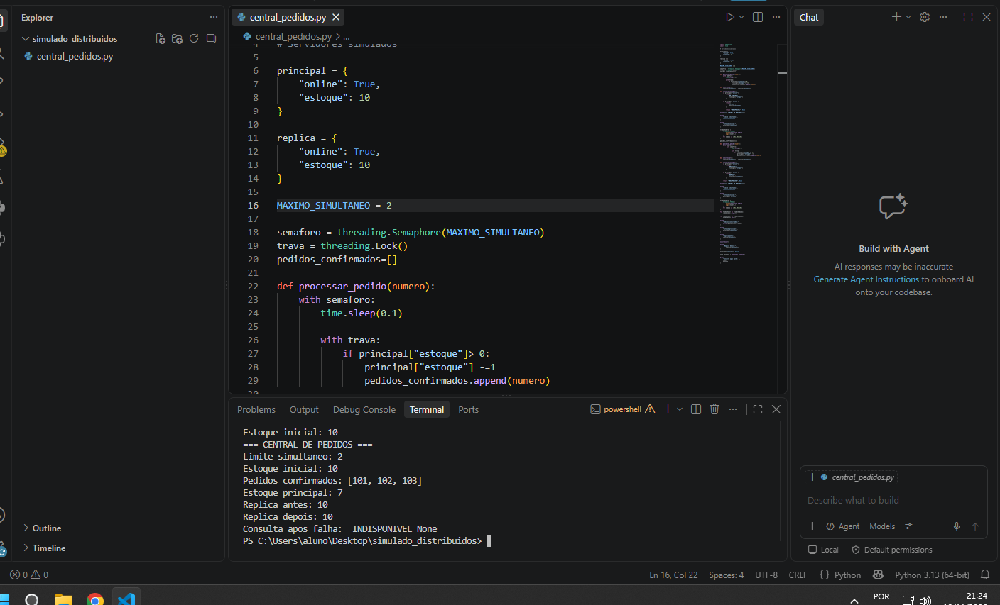
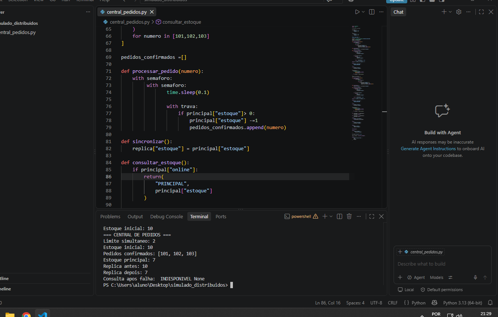

# prova2sistemasdistribuidos

**Professora:** Simone Tatiane do Canto
**Data:** 18/11/2026

## 1 situação problema
 descreva brevemente os problemas apresentados na central de pedidos distribuidas

 r: problema na linha 63 no target=

 ## 2 primeira execução
 
Explique o que foi observado ao executar o programa pela primeira vez

 r: o resultado de Limite simultaneo, Estoque inicial, Pedidos confirmados, Estoque principal, Replica antes e Replica depois e Consulta apos falha

 ### Evidência 1- Primeira execução

 

 ## 3 problema a- concorrencia
 
qual problema foi identificado?
r: limite de 3 inves de 2 pedidos simultaneos

qual a alteração foi a realizad?
r: mudar o numero no  MAXIMO_SIMULTANEO

 ### Evidência 2- Concorrencia

 

  
 ## 4 problema b- replicação e consistência
 

qual problema foi identificado?
r: replica nao atualizava em ostrava o valor antigo

qual a alteração foi a realizad?
r: mudar o nome no def sincronizar():
    replica["estoque"] = replica["estoque"]
    
   para def sincronizar():
    replica["estoque"] = principal["estoque"]
    
        )

   ### Evidência 3- sincronização

 

  ## 5 problema c-tolerancia a falhas
 

qual problema foi identificado?
r: sistema nao permetia permitir consultas quando sistema principal estava indisponivel e mesmo o replica estando disponivel

qual a alteração foi a realizad?
r: mudar o nome no  if replica["online"]:
        return(
            "REPLICA",
            principal["estoque"]
        )
        para if replica["online"]:
        return(
            "REPLICA",
            replica["estoque"]
        )

   ### Evidência 4- tolerancia a falhas

 
 
   ## 6 validação do programa
 

descreva os resultados observados após as três correções

r:Limite simultaneo: 2
Estoque inicial: 10
Pedidos confirmados: [101, 102, 103]
Estoque principal: 7
Replica antes: 10
Replica depois: 7
Consulta apos falha:  REPLICA 7

   ### Evidência 5- Execução completa

 

 questão 1
 R: dar uma pausa no processamento de um estoque para o outro para evitar falhas

 questão 2
 r: para os resultados serem os mesmos e atualizados

questão 3
r: para que quando um dos servidores nao funcionar, conseguir rodar no outro, no caso neste programa indo para a replica

questão 4
r: para bloquear na quantidade permitidas de pedidos silmutaneos

questão 5
r:depois, assim mostrando a quantidade restante no estoque para saber quantos mais pedidos podem ser feitos

aluno: Sabrina Lemos Lopes dos Santos

